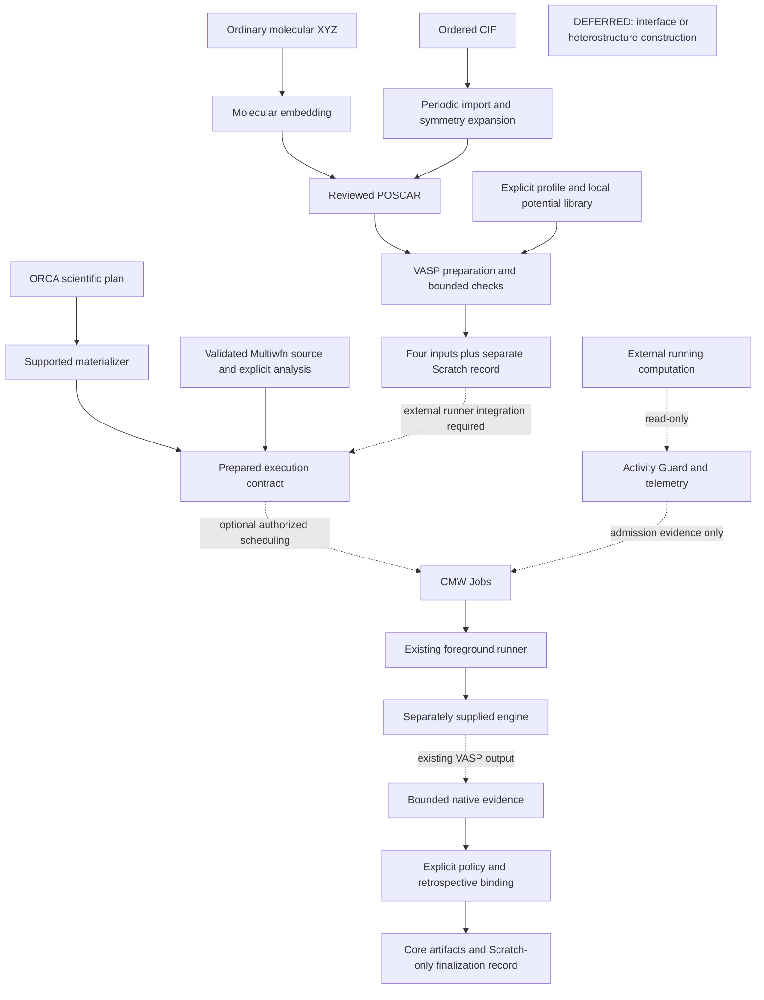

# CMW capability map

**Find an existing route before building another one.** This is a routing index
for the current checkout, not execution authorization or a scientific recipe.
Read the relevant row, then its linked contract, which is authoritative for
scope and limits. Verify the entry point before use, and report any drift.

For a **usage request**, use the supported interface. For **development**, extend
that implementation only after identifying a concrete unsupported requirement or
contract mismatch. A small project adapter can compose existing APIs; it must not
replace their validation, materialization, provenance or execution gates.

**Status labels:**
* **IMPLEMENTED:** the route exists within its contract's scope.
* **PARTIAL:** only the named part exists.
* **EXTERNAL INTEGRATION:** needs a separately supplied implementation.
* **DEFERRED:** an explicit boundary.
* **NOT WIRED / NOT DEPLOYED:** code exists, but no live route uses it.
* **PROCEDURE:** a manual review, not code.

None of these labels certifies science.

**Entry-point forms:**
* `cmw …` is the installed console command.
* `python -m …` is a module entry point.
* Paths under `scripts/` need the checkout or an extracted sdist.
* API rows are importable Python interfaces.

Tests live under `tests/`, mirroring `src/`. Supported platforms are listed in
[tested support](README.md#tested-support).

## Structure

| Task | Entry point | Status and key boundary | Contract |
| --- | --- | --- | --- |
| Put an ordinary molecule in a periodic box | `cmw structure embed-molecule` | IMPLEMENTED; explicit cell, charge and vacuum intent | [Guide](docs/structure/xyz-to-poscar.md) |
| Import an ordered periodic CIF | `cmw structure import-cif` | IMPLEMENTED; ordered, fully occupied CIF only | [Guide](docs/structure/cif-import.md) |
| Validate molecular XYZ / keep geometry identity | `cmw.structure.xyz.read_xyz`, `geometry_hash`; `structure_artifact_from_file` | IMPLEMENTED (API) | [Contract](docs/architecture/orca-status-and-xyz.md) |
| Consume imported periodic geometry | `PeriodicStructure`, `PeriodicAtom` | IMPLEMENTED (API) | [Model](docs/structure/periodic-model.md) |
| Maintain an existing XYZ conversion integration | `scripts/workflows/xyz_to_poscar.sh`; `cmw.structure.conversion.xyz_to_poscar` | IMPLEMENTED, **legacy publication** (overwrites, adjacent sidecars); new work uses `embed-molecule` | [Guide](docs/structure/xyz-to-poscar.md) |

## Periodic and VASP

| Task | Entry point | Status and key boundary | Contract |
| --- | --- | --- | --- |
| Discover local potential variants | `cmw vasp potcar list ELEMENT` | IMPLEMENTED; caller-supplied library, no download | [Guide](docs/periodic/vasp-potcar.md) |
| Build/check POTCAR in POSCAR block order | `cmw vasp potcar build` / `check` | IMPLEMENTED; repeated species blocks preserved | [Contract](docs/periodic/vasp-potcar.md) |
| Prepare static inputs from a reviewed POSCAR | `cmw vasp prepare --spec …` (`calculation: static`) | IMPLEMENTED; POSCAR bytes preserved | [Guide](docs/periodic/vasp-preparation.md) |
| Prepare fixed-cell relaxation | `cmw vasp prepare --spec …` (`calculation: fixed-cell-relaxation`) | IMPLEMENTED; no variable-cell relaxation | [Guide](docs/periodic/vasp-preparation.md) |
| Check an existing four-file bundle | `cmw vasp check-inputs DIRECTORY [--preparation-record …]` | IMPLEMENTED, read-only; a pass is not scientific validation | [Contract](docs/periodic/vasp-input-checking.md) |
| Compare a baseline / retain structure lineage | spec `baseline` / `source_record`; `compare_inputs` | IMPLEMENTED; needs complete hash-matched records | [Guide](docs/periodic/vasp-preparation.md#baseline-comparison-and-structure-lineage) |
| Inspect or assess native VASP result evidence | `cmw vasp inspect-result DIRECTORY [--policy …] [--spec …]`; `inspect_result` / `assess_result` | IMPLEMENTED; bounded 6.6.1 static/fixed-cell; no policy means no acceptance | [Contract](docs/periodic/vasp-result-evidence.md) |
| Analyze SCF or independent electronic levels | `cmw vasp analyze-scf DIRECTORY`; `analyze-electronic DIRECTORY --only …`; `scf_analysis` / `electronic_levels` | IMPLEMENTED; analysis only, no artifact acceptance | [Contract](docs/periodic/vasp-analysis.md) |
| Finalize accepted VASP energies or periodic endpoint | `cmw vasp finalize-result DIRECTORY --policy … --spec …`; `verify-result-record RECORD` | IMPLEMENTED; explicit retrospective binding; no relocation or wavefunction finalization | [Contract](docs/periodic/vasp-result-evidence.md#commands-output-and-reuse) |
| Execute prepared VASP inputs | Caller-supplied foreground runner, optionally through Jobs | EXTERNAL INTEGRATION; no native VASP launcher | [Runner integration](docs/cmw-jobs.md#integration-and-foreground-command-contract) |
| Check the selected managed VASP port interface | `cmw vasp check-runner --runner … [--project-root …] -- <port arguments>` | IMPLEMENTED, read-only; exit 0 means argument compatibility only | [Contract](docs/periodic/vasp-result-evidence.md#check-a-managed-runner-interface) |

The [real-calculation acceptance study](docs/evaluations/real-zis-vasp-acceptance-2026-09.md)
records the bounded native corpus and remaining provenance gaps.

## Molecular workflows

Engines and converters are supplied separately. Planning and preparation never
execute.

| Task | Entry point | Status and key boundary | Contract |
| --- | --- | --- | --- |
| Run OPT, OPT+SP, OPT+FREQ or OPT+FREQ+SP | `scripts/workflows/run_opt_freq_sp.sh` | IMPLEMENTED, checkout workflow; `--plan` does not execute | [Guide](docs/molecular/orca-opt-freq-sp.md) |
| Check and submit reviewed ORCA/Multiwfn Jobs | `cmw jobs check --spec … --json`; `cmw jobs submit --spec … [--preview]`; `--node` equivalents | IMPLEMENTED, bounded profiles; registers on Hold | [Jobs guide](docs/molecular-jobs.md) |
| Suspend/continue a newly enrolled local managed attempt | `cmw jobs suspend JOB [--preview --json]`, `cmw jobs continue JOB`; portal `U` | IMPLEMENTED, bounded qualification; VASP port and ordinary ORCA SP/OPT only | [Jobs contract](docs/cmw-jobs.md#controlled-suspension-of-an-enrolled-local-attempt) |
| Prepare/check/finalize/reuse one ORCA stage | `python -m cmw.molecular.orca.cli` (`prepare`, `status`, `finalize`, `reuse`); runner `scripts/orca/run_orca.sh` | IMPLEMENTED; no `cmw orca` alias | [Lifecycle](docs/architecture/orca-runtime.md) |
| Convert a validated ORCA wavefunction | `scripts/orca/convert_orca_wavefunction.sh` | IMPLEMENTED, checkout workflow; needs a finalized source and supplied converter | [Source contract](docs/molecular/multiwfn-cubes.md#validated-source-contract) |
| Generate HOMO/LUMO, density/ESP or IGMH cubes | `scripts/workflows/generate_{homo_lumo,esp,igmh}_cubes.sh` | IMPLEMENTED; validated source, explicit grids/fragments; IGMH consumes validated density | [Guide](docs/molecular/multiwfn-cubes.md) |
| Prepare/run a two-fragment IFCT revalidation | `scripts/multiwfn/run_ifct.sh SPEC.json NEW_ATTEMPT_DIRECTORY` | IMPLEMENTED, checkout runner; Multiwfn 2026.7.15 grammar | [Spec and finalizer](src/cmw/molecular/multiwfn/ifct_job.py) |
| Render/parse NTO and non-fragment hole/electron analysis | `cmw.molecular.multiwfn.excited_states`; `cmw.molecular.stacking.hole_electron` | IMPLEMENTED (API); no automatic CT-like state choice | [Guide](docs/molecular/multiwfn-3.8-excited-state-analysis.md) |
| Plan/assemble intermolecular LED | `python -m cmw.molecular.workflows.intermolecular_led_cli` (`plan`, `finalize`, `reuse`) | IMPLEMENTED; fixed geometry, two explicit fragments | [Guide](docs/molecular/orca-intermolecular-led.md) |
| Extract a molecular registry / assemble a vertical dimer | `extract_stacking_template`, `assemble_vertical_dimer` | IMPLEMENTED (API); not slab/interface assembly | [Guide](docs/architecture/vertical-stacking-workflow.md) |

## Execution and operations

| Task | Entry point | Status and key boundary | Contract |
| --- | --- | --- | --- |
| Schedule prepared foreground commands sequentially | `cmw jobs add`, then separately authorized `start` | IMPLEMENTED; `add` only enqueues | [Guide](docs/cmw-jobs.md#prepared-jobs-and-controls) |
| Identify managed jobs in history | `cmw jobs status`, `show JOB_ID`, `watch` | IMPLEMENTED | [Guide](docs/cmw-jobs.md#prepared-jobs-and-controls) |
| Annotate a managed job | `cmw jobs add --note`, `annotate JOB_ID --note` / `--clear-note`; `watch` N | IMPLEMENTED; never scheduling or scientific evidence | [Contract](docs/cmw-jobs.md#managed-job-notes) |
| Discover managed job files / open a declared folder | `cmw jobs files JOB_ID [--json] [--open --role output]`; `watch` Files / F | IMPLEMENTED, read-only | [Guide](docs/cmw-jobs.md#file-locations-and-folder-navigation), [location API](docs/cmw-jobs-locations.md) |
| Observe selected-job live progress and history | `cmw jobs progress JOB_ID [--history --limit N --cursor …] [--json]`; `watch` card, G, S, Y | IMPLEMENTED, read-only; bounded VASP 6.6.1 and ORCA 6.1.x readers; no ETA or acceptance | [Contract](docs/cmw-jobs-progress.md), [ORCA scope](docs/molecular/orca-live-progress.md) |
| Declare future scientific progress sources | `cmw jobs add --progress-source ROLE[@STAGE]=ABSOLUTE_PATH` | IMPLEMENTED, optional; user-declared, not verified provenance | [Contract](docs/cmw-jobs-progress.md#declarations-for-future-jobs) |
| Bind staged POSCAR for new supported VASP attempts | `Store.add` / `cmw jobs add` with managed `run-vasp.sh` argv | IMPLEMENTED, bounded; new attempts only | [Contract](docs/cmw-jobs-progress.md#automatic-poscar-identity-for-future-vasp-attempts) |
| Review one selected scientific result on its owner node | `cmw jobs review JOB [--inspect] [--policy … --spec …] [--export …] --json`; `watch` R | IMPLEMENTED, bounded; no finalization or job mutation | [Contract](docs/cmw-jobs-result-review.md) |
| Plan and prepare an explicit successor calculation | `cmw jobs plan-next` / `materialize-next` / `register-next` | IMPLEMENTED, geometry-only; no automatic execution | [Contract](docs/cmw-jobs-successors.md) |
| Plan and compare an explicit VASP convergence study | `cmw jobs study plan/materialize/register/compare/view`; catalogue S | IMPLEMENTED, bounded static subset; at most 64 cases | [Contract](docs/cmw-jobs-studies.md) |
| Organize and query research attempts | `cmw jobs query`; `catalogue show/edit/relations/relate/retract`; `watch` Search, T | IMPLEMENTED, bounded; human metadata only | [Contract](docs/cmw-jobs-catalogue.md) |
| Run one independent auxiliary beside a primary | `cmw jobs config --mode bounded-sharing`; `sharing` / `add` declarations | IMPLEMENTED; one primary and one auxiliary, explicit consent | [Guide](docs/cmw-jobs.md#bounded-sharing-one-primary-and-one-auxiliary) |
| Permit coexistence with an external computation | `cmw jobs reserve OBSERVATION_ID`, `unreserve` | IMPLEMENTED; never starts jobs or adopts processes | [Guide](docs/cmw-jobs.md#external-vasp-plus-a-prepared-independent-analysis) |
| Observe external VASP/ORCA/Multiwfn and the admission guard | `cmw jobs status`, `watch`, `show E…` | IMPLEMENTED, read-only; no adoption | [Guide](docs/cmw-jobs.md#external-activity-and-admission-guard) |
| Inspect current CPU/RAM and optional CPU temperature | `cmw jobs status --json`, `show`, `watch` | IMPLEMENTED; temperature is never an admission input | [Guide](docs/cmw-jobs.md#current-cpu-and-ram-usage) |
| Observe active/offline managed execution | `cmw jobs observe JOB_ID [--json]` | IMPLEMENTED, read-only | [Contract](docs/cmw-jobs.md#offline-lifecycle-observations) |
| Diagnose local process ownership | `cmw jobs ownership JOB [--role group\|worker\|controller] [--json]` | IMPLEMENTED, read-only; exit 0/2/75 = VERIFIED/GONE/UNVERIFIABLE | [Guide](docs/cmw-jobs.md) |
| Recover transient ownership and completion observations | Original Jobs worker | IMPLEMENTED, NOT DEPLOYED; no worker-death recovery ([#23](https://github.com/angzeli/computational-modelling-workflow/issues/23)) | [Recovery contract](docs/cmw-jobs.md#process-domain-never-observed) |
| Understand a managed Unknown attempt | `cmw jobs show JOB_ID`, `observe JOB_ID`, `logs JOB_ID` | IMPLEMENTED, read-only; no force-Done or takeover | [Guide](docs/cmw-jobs.md#persistence-lifecycle-and-recovery) |
| Preview conservative lifecycle reconciliation | `cmw jobs reconcile JOB_ID --preview [--json]` | IMPLEMENTED, read-only; apply DEFERRED | [Contract](docs/cmw-jobs.md#offline-lifecycle-observations) |
| Retire an Unknown attempt whose recorded execution is gone | `cmw jobs --state QUEUE_STATE retire JOB --reason TEXT [--json]` | IMPLEMENTED, local only; every recorded identity must be GONE | [Contract](docs/cmw-jobs-retirement.md) |
| Diagnose a runtime, node/job or capability; export a support capsule | `cmw doctor [--state STATE --job JOB \| --node ALIAS --queue QUEUE] [--capability NAME] [--json] [--export NEW_DIRECTORY]`; Details → D | IMPLEMENTED, read-only | [Contract](docs/cmw-doctor.md) |
| Submit to and observe explicitly enrolled execution nodes | `cmw nodes enroll/connect/list/check`; `cmw jobs --node ALIAS --queue QUEUE …`; `cmw jobs watch --all-nodes` | IMPLEMENTED, explicit; bounded SSH endpoint, no pooled scheduler | [Contract](docs/cmw-dual-node.md) |
| Classify node failure and recover observation | `transport_events`, `NodesApp` per-node lanes | IMPLEMENTED P1 CODE, NOT DEPLOYED | [Node guide](docs/cmw-dual-node.md#portal-reachability-and-recovery) |
| Read node telemetry independently of status polling | `cmw.nodes.telemetry.NodeTelemetry` | IMPLEMENTED P1 CODE, NOT DEPLOYED | [Node guide](docs/cmw-dual-node.md) |
| Verify runtime trust for a status response | `RuntimeVerifier.verify_request`, `runtime_boundary_observed` | IMPLEMENTED P1 CODE, NOT DEPLOYED | [Trust contract](docs/cmw-dual-node.md#runtime-metadata-and-operation-authority) |
| Record and inspect runner interpreter pins | `cmw.nodes.runner_profiles`, profile schema 2 | IMPLEMENTED P1 DATA, NOT DEPLOYED; no launch enforcement | [Guide](docs/cmw-dual-node.md#runner-interpreter-profile-records) |
| Evaluate cancellation and node observation decisions | `cmw.nodes.contracts` | CANCELLATION UNWIRED; OBSERVATION WIRED IN P1 | [Specification](docs/architecture/multi-host-nodes.md) |
| Assess an author-supplied VASP plan for a target node | `cmw.nodes.vasp_plan.plan_vasp`, `Hardware`, `VaspPlan.require_submission` | PHASE 0 CONTRACTS, NOT WIRED | [Specification](docs/architecture/multi-host-nodes.md#37-author-inputs-runner-hardware-and-builds-d17d22) |
| Qualify parity with deployed CMW revisions | Required cutover review | PROCEDURE | [Parity procedure](docs/architecture/deployed-runtime-parity.md) |

**Independent Multiwfn beside external VASP:** choose a supported prepared
analysis runner, verify its actual thread and memory use, identify the live
external observation and obtain explicit coexistence consent. Then declare the
reservation, auxiliary resources and disjoint write scope in the same Jobs state,
and request execution authorization. Low usage or a passing help command grants
none of these.

## Shared mechanisms

| Task | Entry point | Status and key boundary | Contract |
| --- | --- | --- | --- |
| Express task intent / execution resources | `ExecutionIntent`, `load_execution_profiles` | IMPLEMENTED (API); memory declaration is not enforcement | [Profiles](docs/architecture/execution-resource-profiles.md) |
| Materialize dependency-ready workflow nodes | `WorkflowPlanMaterializer`; `python -m cmw.molecular.orca.cli materialize-plan` | IMPLEMENTED; no launch, no universal VASP renderer | [Guide](docs/architecture/workflow-plan-materialization.md) |
| Preserve identities, provenance and artifact lineage | `JobTarget`, `ExecutionAttempt`, `Artifact`; `finalize_artifact_bundle` | IMPLEMENTED (API) | [Graph/artifact contract](docs/architecture/composite-workflow-engine.md) |
| Publish prepared inputs apart from provenance | `publication_plan`, `publish_preparation`, `inspect_publication`; `record_publication_plan`, `publish_record` | IMPLEMENTED (API); no-clobber staging | [Contract](docs/periodic/preparation-publication.md) |
| Resolve/migrate execution layouts | `ExecutionLayout`; `cmw execution-layout-status`; `cmw migrate-execution-layout` | IMPLEMENTED; plan first, apply needs exact confirmation | [Guide](docs/execution-layout-v2.md) |
| Clean provably superseded attempts | `cmw cleanup-attempts --campaign … --superseded-only` | IMPLEMENTED; dry run by default, purge needs `--confirm-plan` | [Guide](docs/architecture/attempt-cleanup.md) |
| Stage execution on external Scratch | ORCA runner external-scratch options; `prepare_external_scratch`, `copy_back_external_scratch`, `cleanup_external_scratch` | IMPLEMENTED; no fallback when unavailable | [Runner lifecycle](docs/architecture/orca-runtime.md) |
| Inspect process health / disk admission | `cmw.core.process_health`; `check_storage_capacity` | IMPLEMENTED (API); advisory, never scientific success | [Health guide](docs/architecture/process-health.md) |

## Analysis and reporting

| Task | Entry point | Status and key boundary | Contract |
| --- | --- | --- | --- |
| Prepare DOS/projection/band-path arrays | `cmw.analysis.electronic` | IMPLEMENTED (API); caller owns readers and plotting | [Guide](docs/electronic-arrays.md) |
| Normalize/join excited-state results | `normalize_tda_manifold`, `join_excited_state_tables` | IMPLEMENTED (API) | [State contract](docs/molecular/orca-6.1-tda-excited-states.md) |
| End-to-end periodic result reporting | VASP evidence/finalization plus array preparation | PARTIAL; general readers and reports not implemented | [Result contract](docs/periodic/vasp-result-evidence.md) |

## Workflow boundaries at a glance



Dotted arrows are optional orchestration, external integration or read-only
evidence. Preparation never starts the execution branch automatically.

## High-risk routing distinctions

* **Molecular embedding versus periodic import.**
  * Use embedding only to *construct* a periodic model from ordinary molecular
    XYZ. It is not lossless periodic conversion, and it rejects periodic extended
    XYZ and CIF.
  * Ordered CIF goes to `cmw structure import-cif`, never to embedding or an ad
    hoc ASE script.
  * The [CIF contract](docs/structure/cif-import.md) defines block selection,
    occupancy, symmetry expansion, orientation and site mappings.
* **Prepared POSCAR.** Check or prepare a reviewed POSCAR directly. Do not
  re-embed, sort, wrap, center or regenerate it.
* **POTCAR.** It is supplied locally. CMW never bundles or fetches it, and real
  payloads must not enter Git. Element/variant, exact selected bytes and the
  declared library release are different evidence.
* **Evidence is not success.**
  * Preparation is not execution.
  * An input-check pass is not SCF or ionic convergence.
  * Jobs Done is operational completion, not scientific success.
  * ORCA validation needs stage-specific evidence.
* **Outputs.**
  * Canonical VASP preparation writes exactly `INCAR`, `KPOINTS`, `POSCAR` and
    `POTCAR`, plus `preparation.json` in an explicit Scratch record directory.
  * Embedding and CIF import write `POSCAR` plus that record.
  * Neither writes adjacent metadata, a README or `run.sh`.
  * Molecular workflows follow their own layouts.
  * See [split publication](docs/periodic/preparation-publication.md).

## Known gaps and deferred capabilities

| Task | Availability / boundary |
| --- | --- |
| Two CIFs into an interface or heterostructure | DEFERRED; model construction, not concatenation. [Handoff](docs/structure/cif-import.md#future-interface-construction-handoff) |
| Disordered, magnetic, superspace or unsupported special CIF | Not supported; do not resolve the model by choosing occupancies or bypassing the importer |
| Native VASP launch and general result validation | Not implemented beyond bounded static/fixed-cell evidence. [Scope](docs/periodic/vasp-result-evidence.md#native-dialect-and-modes) |
| Cluster scheduling, cluster locks, backfill or generic retry ladders | Outside the local contracts. [Jobs limits](docs/cmw-jobs.md) |
| Automatic CT-like state choice or general fragment-resolved HEA | DEFERRED. [Analysis boundary](docs/molecular/multiwfn-3.8-excited-state-analysis.md#unsupported-and-deferred-analysis) |

## Using CMW from another project

CMW's AGENTS.md and this map are not loaded automatically in another repository;
that project's guidance must point here. If a command seems missing, first
identify the selected installation and interpreter:

```sh
command -v cmw
cmw --help
# CMW_PYTHON is the interpreter belonging to that selected installation.
"$CMW_PYTHON" -c 'import sys, cmw; from importlib.metadata import version; print(sys.executable); print(cmw.__file__); print(version("computational-modelling-workflow"))'
# From a declared checkout whose dependencies are available:
PYTHONDONTWRITEBYTECODE=1 PYTHONPATH="$CMW_CHECKOUT/src" "$CMW_PYTHON" -m cmw.cli structure import-cif --help
```

A failed help command, stale installation or wrong environment does not prove a
capability is missing, and CLI absence does not prove API absence. Report the
mismatch; do not install, duplicate or bypass silently.

Copyable consumer-project guidance (`CMW_CHECKOUT` is a placeholder to resolve):

> Locate the declared `CMW_CHECKOUT` and read its root `CAPABILITY_MAP.md` plus the
> relevant feature contract. Verify that the selected installation exposes the
> required CLI/API, or use the documented checkout workflow. Prefer that capability
> over a duplicate local implementation. Keep this project's instructions,
> scientific choices and execution-approval requirements in force. Report missing
> or unsupported requirements; do not silently bypass CMW checks. This reference
> supplies routing guidance, not the whole CMW repository policy.

## Maintenance

* A change that adds, renames, removes or materially changes a user-facing
  capability updates its row in the same change.
* Keep rows to one line: details belong in the linked contract, which stays
  authoritative.
* Do not add test counts, test links or version-based maturity claims.
